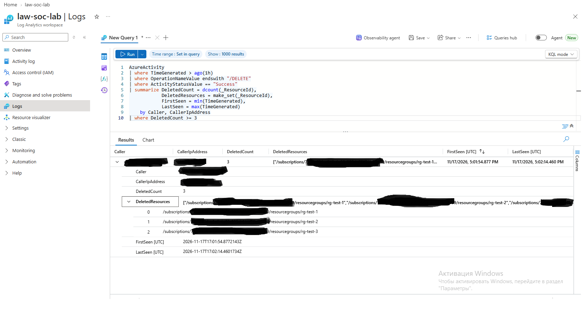
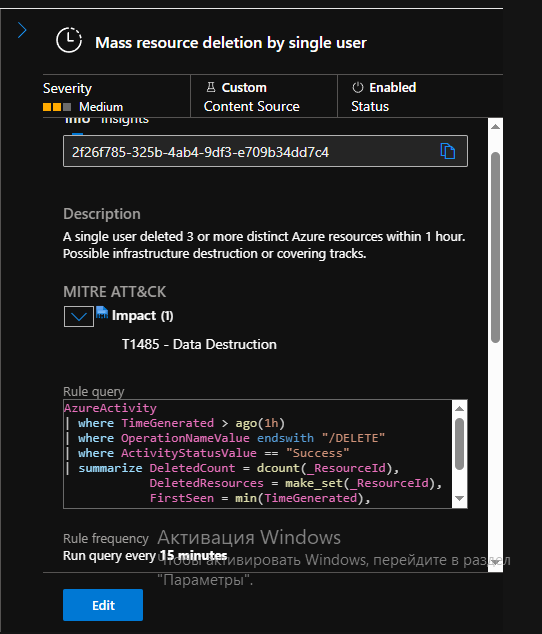
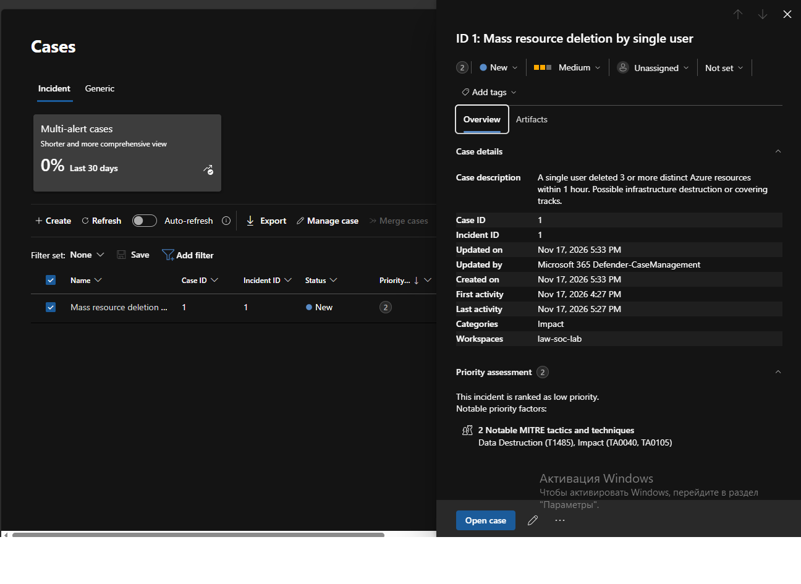
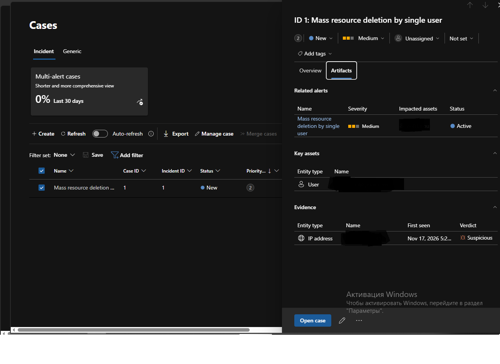

# Sentinel Detection Lab

My home lab for building and testing detection rules in Microsoft Sentinel.
I work as a SOC analyst and wanted hands-on experience on the other side:
connecting log sources and writing the rules that create alerts.

## Lab setup

Azure Activity log -> Log Analytics workspace -> Microsoft Sentinel -> Analytics rule -> Incident

- Log Analytics workspace with Microsoft Sentinel enabled (UK South)
- Azure Activity data connector, deployed through Azure Policy
- Sentinel managed through the Microsoft Defender portal
- Budget alert set to keep the lab cost near zero

## Rule 1: Mass resource deletion by single user

**File:** `rules/mass-resource-deletion.kql`

**What it detects:** one user deletes 3 or more different Azure resources within one hour.
This can mean an attacker destroying infrastructure or removing evidence.

**MITRE ATT&CK:** Impact (TA0040), T1485 Data Destruction

**Rule settings**
- Runs every 15 minutes, looks at the last 1 hour
- Entity mapping: Account (Caller), IP (CallerIpAddress)
- Alert grouping: one incident per user and IP within 1 hour

## Testing

- **Negative test:** deleted one storage account. The rule did not fire.
- **Positive test:** created and deleted three empty resource groups. The rule fired and Sentinel created an incident with the user and IP as entities.

## Problems I found while testing

1. **Fixed time bins split events.** I first used `bin(TimeGenerated, 1h)`. Two deletions 10 minutes apart (12:50 and 13:00) fell into different bins, so the rule missed them.
2. **Counting events instead of resources.** Azure logged two successful delete events for one storage account. With `count()` one deletion looked like two. I changed it to `dcount(_ResourceId)` to count unique resources.
3. **Lookback window too wide.** With a 24h window, an old deletion moved `FirstSeen` back by hours and hid three new deletions. I limited the query to 1 hour, matching the rule schedule.

## Screenshots

**Query result**

**Analytics rule**

**Incident**

**Entities**

Personal identifiers (email, IP, subscription ID) are redacted.

## Next steps

- More rules on Azure Activity (role assignments, diagnostic settings deleted)
- Sigma versions of the rules
- Automated response with a Logic Apps playbook
